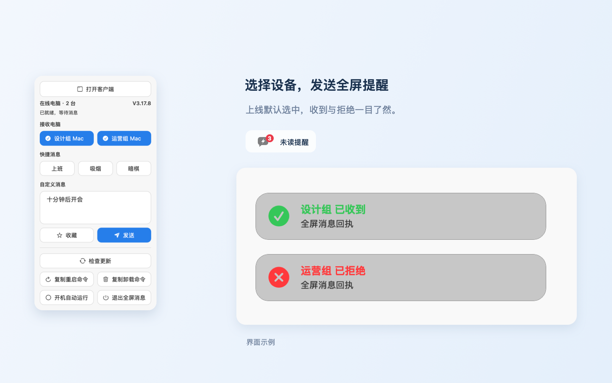
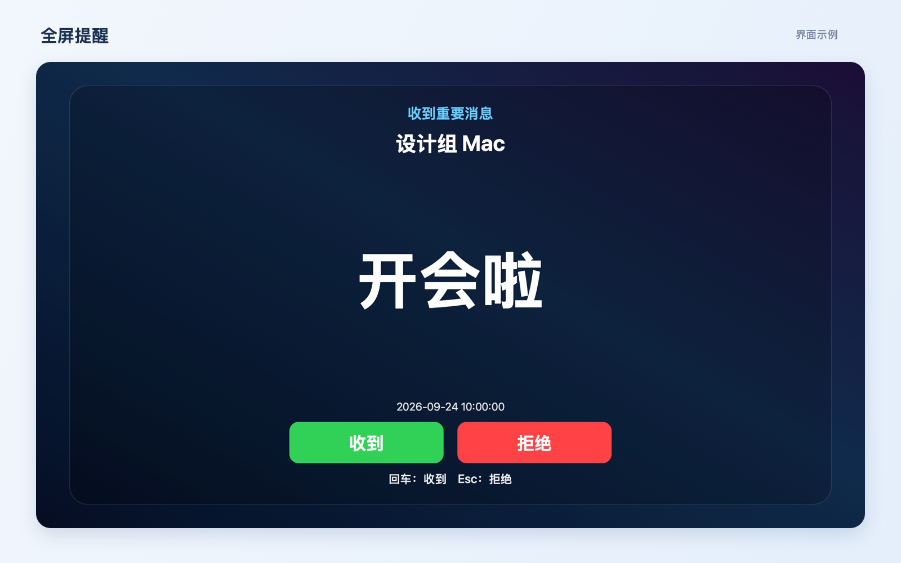

# 全屏消息 for Mac

适用于 Apple M 芯片 Mac 的菜单栏局域网消息工具。同一局域网内的 Mac 会自动发现彼此，无需账号和配对；任意一方发送消息后，接收方的全部显示器会同时全屏显示。


## 功能

- **后台运行**：常驻菜单栏，不占 Dock，支持开机自启。
- **设备互联**：自动发现同一局域网的 Mac，上线设备默认选中，可手动取消；支持多选发送、设备备注和移除；收到消息时优先显示本机备注。
- **全屏提醒**：所有显示器同时展示大字消息，放大显示区域和“收到／拒绝”按钮；回车确认收到，Esc 拒绝，并向发送者返回处理结果；回执通知停留 5 秒，多条纵向排列，超出屏幕空间时排队展示。
- **快捷发送**：菜单按屏幕空间完整展开，无需上下滚动；提供预设消息、自定义输入和收藏，快捷消息可拖动排序并自动保存，支持连续发送并显示发送结果，失败保留草稿；连续收到的全屏消息依次展示。
- **未读角标**：显示未读数量，已收到的待处理消息在锁屏、重启后仍保留。
- **自动更新**：发现新版本后后台安装并重启，也支持命令行安装、更新和卸载。

## 界面预览





<sub>界面使用演示设备与消息内容。</sub>

## 命令行安装

打开“终端”，执行：

```bash
curl -fsSL "https://github.com/hbiszxm/mac-fullscreen-message/releases/latest/download/install-latest.sh?cache=$(date +%s)" | /bin/bash
```

根据提示输入当前 Mac 的登录密码。脚本会下载最新版、覆盖旧版本并自动启动。

## 网页下载安装

1. 打开 [最新版本下载页面](https://github.com/hbiszxm/mac-fullscreen-message/releases/latest)。
2. 下载 `FullscreenMessage-AppleSilicon.pkg`。
3. 双击安装包并按提示安装。
4. 首次运行时允许访问“本地网络”。

只支持 Apple M 芯片 Mac，最低系统版本为 macOS 13。

## 使用菜单

点击屏幕顶部菜单栏中的消息图标，即可选择接收电脑、发送或收藏自定义消息、拖动调整快捷消息顺序。检查更新、开机自动运行、复制重启和卸载命令也在同一面板中，无需打开独立窗口。

## 在线更新

启动后约 8 秒自动检查更新，之后每 6 小时检查。发现新版本后后台下载、安装并重新启动。也可以在顶部消息图标面板点击“检查更新”立即检查。

## 命令行更新

更新和首次安装使用同一条命令：

```bash
curl -fsSL "https://github.com/hbiszxm/mac-fullscreen-message/releases/latest/download/install-latest.sh?cache=$(date +%s)" | /bin/bash
```

## 命令行卸载

执行：

```bash
curl -fsSL "https://github.com/hbiszxm/mac-fullscreen-message/releases/latest/download/uninstall.sh?cache=$(date +%s)" | /bin/bash
```

卸载脚本会清理后台进程、开机启动、应用文件和本地设置。

## 手动卸载

1. 点击顶部消息图标菜单，选择“退出全屏消息”。
2. 在“应用程序”文件夹删除“全屏消息.app”。
3. 如已启用开机启动，在“系统设置 → 通用 → 登录项与扩展”中将其关闭。

## 从源码构建

需要 Xcode 命令行开发环境：

```bash
./scripts/build.sh
```

构建产物位于 `build/`：

- `全屏消息.app`
- `全屏消息-Apple芯片-v3.17.11.pkg`
